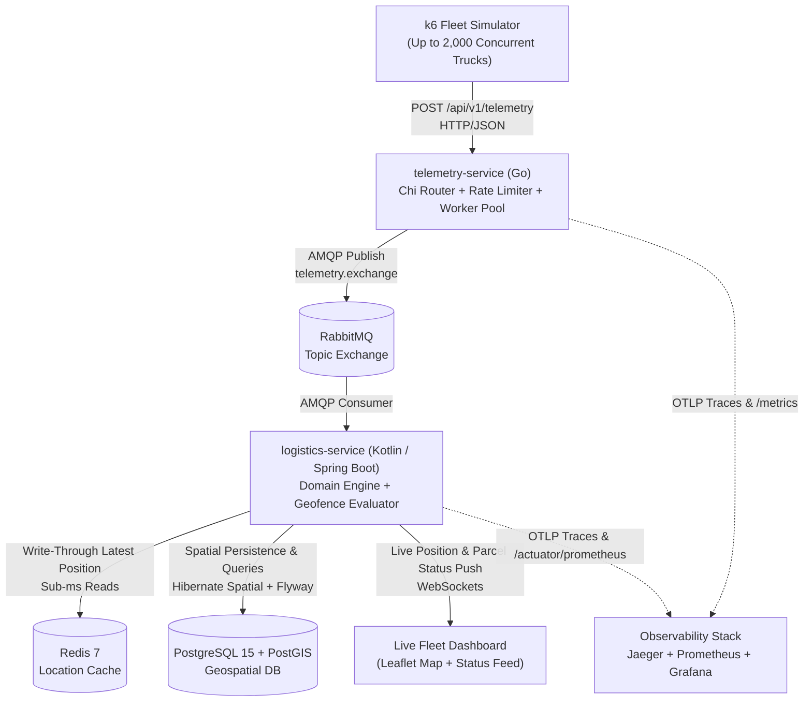
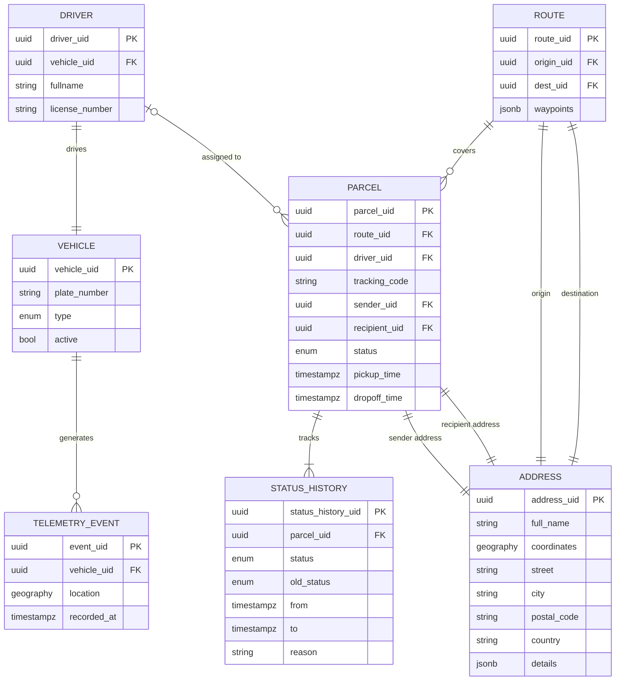

# GPS Logistics Tracker

**Real-Time Polyglot Fleet Telemetry & Parcel Tracking Backend (`Go` + `Kotlin` + `RabbitMQ` + `PostGIS` + `Redis`)**

[](https://kotlinlang.org/)
[](https://go.dev/)
[](https://spring.io/projects/spring-boot)
[](https://www.rabbitmq.com/)
[](https://postgis.net/)
[](https://redis.io/)
[](https://opentelemetry.io/)

---

## Overview

`gps-logistics-tracker` is a distributed, event-driven backend system designed to ingest high-frequency GPS telemetry from delivery fleets and power real-time parcel tracking, geofenced delivery status transitions, and live map streaming.

The system splits responsibilities across two purpose-built microservices:
1. **`telemetry-service` (Go):** A lightweight, low-latency ingestion edge service using a bounded buffered channel and worker pool pattern to absorb bursty GPS pings from thousands of concurrent vehicles and publish them asynchronously to **RabbitMQ**.
2. **`logistics-service` (Kotlin / Spring Boot):** A rich domain service managing drivers, routes, parcels, and spatial queries. It consumes telemetry events from RabbitMQ, caches live vehicle coordinates in **Redis**, persists spatial history in **PostgreSQL/PostGIS**, automatically transitions parcel states (`CREATED` → `PICKED_UP` → `IN_TRANSIT` → `DELIVERED`) via geofence proximity checks, and pushes real-time updates to clients via **WebSockets**.

---

## System Architecture



### Why a Polyglot Architecture (`Go` + `Kotlin`)?

* **Edge Ingestion in Go (`telemetry-service`):** Telemetry ingestion is I/O-bound, high-concurrency, and stateless. Go's small memory footprint, fast startup, and native goroutine worker pool (`internal/worker/pool.go`) allow a single instance to validate payloads, apply token-bucket rate limiting, and buffer spikes in memory before publishing to RabbitMQ with `p95 < 10ms` latency.
* **Core Domain & Spatial Analytics in Kotlin (`logistics-service`):** Fleet management, parcel lifecycle state machines, transactional audit history (`status_history`), and spatial distance calculations benefit from **Spring Boot**, **Hibernate Spatial / JTS**, **Flyway** schema migrations, and Kotlin's expressive type system.

---

## Data Model (Entity-Relationship Diagram)



---

## Quick Start (Docker Compose)

The entire stack—including both microservices, **PostGIS**, **Redis**, **RabbitMQ**, **Jaeger**, **Prometheus**, and **Grafana**—starts with a single command:

```bash
docker compose up -d --build
```

### Local Endpoints & Dashboards

| Component | URL | Credentials / Notes |
| :--- | :--- | :--- |
| **Live Fleet Map Dashboard** | `http://localhost:8080/dashboard.html` | Real-time WebSocket map & parcel status feed |
| **Logistics Service (Kotlin)** | `http://localhost:8080/api/v1/dashboard/...` | REST API (`drivers`, `parcels`, `parcel/assign`) |
| **Telemetry Service (Go)** | `http://localhost:8090/api/v1/telemetry` | Ingestion endpoint (`/healthz`, `/metrics`) |
| **Grafana Dashboards** | `http://localhost:3000` | Pre-provisioned JVM, Go & throughput dashboards |
| **Jaeger Distributed Tracing** | `http://localhost:16686` | End-to-end OTLP traces (`telemetry-service` → `logistics-service`) |
| **RabbitMQ Management UI** | `http://localhost:15672` | `admin` / `password` |
| **Prometheus UI** | `http://localhost:9090` | Scrapes both Go and Spring Actuator metrics |

---

## Load Testing & Fleet Simulation (k6)

The repository includes [k6](https://k6.io/) load-testing and live simulation scripts under [`telemetry-service/load_test/`](telemetry-service/load_test/) and targets in [`telemetry-service/Makefile`](telemetry-service/Makefile) that provision drivers, routes, and parcels and stream continuous GPS coordinates:

```bash
cd telemetry-service

# Quick live simulation (10 drivers, 10 parcels)
make sim-small

# Full live demo (100 drivers, 100 parcels)
make sim-full

# High-concurrency stress test (500 drivers, 500 parcels)
make sim-stress

# 2,000-driver ingestion benchmark
make load-test-full
```

---

## Documentation & Architecture Decisions

* **OpenAPI 3.0 Specification:** [`docs/api/telemetry-openapi.yaml`](docs/api/telemetry-openapi.yaml)
* **ADR — REST vs. gRPC for Telemetry Ingestion:** [`docs/decisions/grpc-vs-rest.md`](docs/decisions/grpc-vs-rest.md) *(evaluates payload size, throughput trade-offs, and the v2 Protobuf contract)*

---

## Project Structure

```text
gps-logistics-tracker/
├── docker-compose.yml            # Full local stack (Go, Kotlin, PostGIS, Redis, RabbitMQ, Jaeger, Prometheus, Grafana)
├── docs/
│   ├── api/                      # OpenAPI 3.0 specification for telemetry ingestion
│   └── decisions/                # Architecture Decision Records (ADRs)
├── monitoring/                   # Prometheus scrape config & Grafana dashboard provisioning
├── telemetry-service/            # Go 1.24 ingestion microservice
│   ├── cmd/server/               # HTTP server entrypoint & graceful shutdown
│   ├── internal/
│   │   ├── handler/              # REST ingestion handlers
│   │   ├── middleware/           # Rate limiter, API key auth, Zap logger, Prometheus metrics
│   │   ├── queue/                # RabbitMQ AMQP publisher
│   │   ├── telemetry/            # OpenTelemetry OTLP tracer setup
│   │   └── worker/               # Concurrent goroutine worker pool & buffered channel
│   └── load_test/                # k6 fleet simulation & stress-test suites
└── logistics-service/            # Kotlin 2.2 / Spring Boot 4 domain microservice
    └── src/main/
        ├── kotlin/.../           # Domain modules (driver, parcel, route, address, telemetryevent), WebSockets & Redis cache
        └── resources/
            ├── db/migration/     # Flyway SQL/PostGIS migrations
            └── static/           # Live WebSocket fleet map dashboard
```
